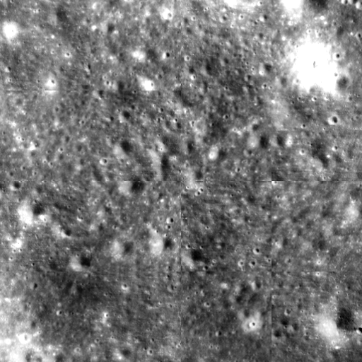
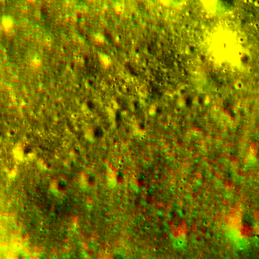
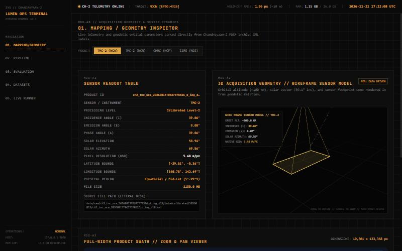
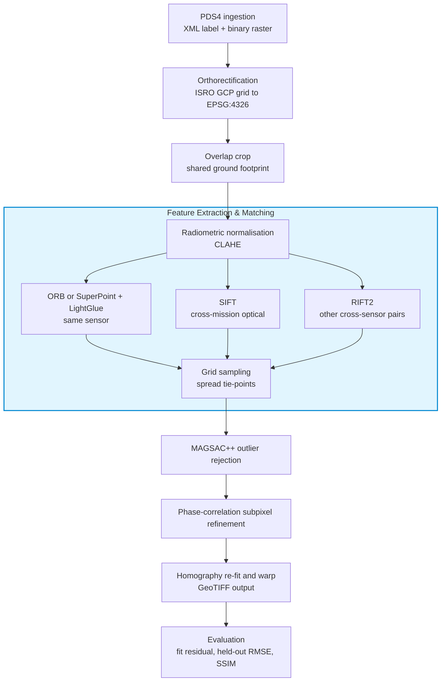

# LUMEN — Lunar Multi-sensor Registration

[](https://github.com/anshulec23-cloud/isro-chandrayaan/actions/workflows/tests.yml)

LUMEN aligns (co-registers) orbital images of the Moon from ISRO's **Chandrayaan-2**: the
Terrain Mapping Camera (TMC-2), the Orbiter High Resolution Camera (OHRC) and the Imaging
Infrared Spectrometer (IIRS). It reads PDS4 products straight from the PRADAN archive,
orthorectifies them from ISRO's ground-control-point grids, crops both images to their shared
ground footprint, matches features, and fits a projective transform with MAGSAC++.

Built for **Smart India Hackathon 2026, problem statement SIH26166 (ISRO)**: *multi-modal,
sun-angle and scale invariant image correspondence using Chandrayaan-2 optical images.*



*Checkerboard of the registered TMC-2 aft (source) and nadir (reference) images, 2.6 × 2.6 km
detail at 5.2 m/px. Crater rims continue across tile seams.*

## Measured results

Every number below comes from [`scripts/benchmark.py`](scripts/benchmark.py) and is stored in
[`docs/results/benchmark.json`](docs/results/benchmark.json).
Hardware: **CPU only**, 12th Gen Intel Core i5-12450H; no GPU. Python 3.11, OpenCV 5.1.

Accuracy is the **held-out RMSE**: the homography is re-fitted on 80 % of the inlier tie-points
and measured on the 20 % it never saw (5-fold cross-validation). The fit residual on the points
used for fitting is in the JSON too, but it is optimistic by construction.

| Pair | Region | Grid | Matcher | Tie-points (inliers / candidates) | Held-out RMSE | On the ground | Runtime |
|---|---|---|---|---|---|---|---|
| TMC-2 aft → TMC-2 nadir | 12 × 12 km window | 5.2 m/px | SIFT | 92 / 371 (25 %) | **1.96 px** | **≈ 10 m** | 4 s |
| TMC-2 aft → TMC-2 nadir | 12 × 12 km window | 5.2 m/px | ORB | 62 / 342 (18 %) | 1.87 px | ≈ 10 m | 3 s |
| TMC-2 nadir → SELENE TC (JAXA) | 12 × 12 km window | 5.5 m/px | SIFT | 62 / 145 (43 %) | **1.86 px** | **≈ 10 m** | 3 s |
| TMC-2 nadir → SELENE TC (JAXA) | full 4,700 km² overlap | 44 m/px | SIFT | 149 / 174 (86 %) | 0.81 px | ≈ 36 m | 4 s |
| TMC-2 aft → TMC-2 nadir | full 22°-long overlap | 332 m/px | SIFT | 187 / 247 (76 %) | 1.66 px | ≈ 550 m | 49 s |

What these numbers mean:

* **Accuracy is about 2 px (≈ 10 m) at native resolution, not sub-pixel.** The aft/nadir pair
  is a ±26° stereo pair, and terrain relief produces parallax that a single planar homography
  cannot absorb. Points with more than ~3 px of parallax are rejected, which is also why the
  inlier ratio at native resolution is 18–43 %, below the 70 % target in the PRD.
* **Sub-pixel figures only appear on heavily downsampled grids.** 0.81 px at 44 m/px is
  36 m on the ground. Compare runs in ground metres, not pixels.
* **RIFT2 did not converge on any real native-resolution pair** (≤ 7 inliers). It works on
  synthetic tests, including inverted contrast, but is not yet usable on this data.
* **OHRC was not benchmarked.** No OHRC product in the downloaded archive overlaps a TMC-2 or
  IIRS product (see [Data](#data)), so OHRC → TMC-2 registration has not been measured.

Reproduce (needs the products below in `data/raw/`):

```bash
python scripts/benchmark.py
```

### Overlay



*False-colour overlay of the same window: red = registered aft image, green = nadir reference.
Agreement shows as yellow/grey; the red/green fringes are stereo parallax and the different
illumination of the two looks.*

### Dashboard



## How it works



### Status of each component

| Component | Status |
|---|---|
| PDS4 ingestion (OHRC, TMC-2, IIRS) | Built and tested; used in all results above. |
| Orthorectification from ISRO GCP grids | Built and tested; used in all results above. |
| DEM height correction (LOLA / SLDEM) | **Supported, not used in any result.** `orthorectify()` accepts a DEM and samples GCP heights from it, but no DEM was available, so all results use a flat datum (z = 0), which leaves terrain parallax uncorrected. |
| Photometric normalisation (Lommel-Seeliger / Minnaert) | **Built, but has no effect in the automated pipeline.** Without a DEM, incidence and emission angles are one value per scene, so the correction is a single brightness gain that CLAHE removes. A run with and without it gives identical results (149 inliers, 0.794 px on TMC-2 → SELENE). |
| Feature matching: ORB, SIFT | Built, tested, used in results. |
| Feature matching: SuperPoint + LightGlue | Built; activates when the optional `lightglue` package is installed. **Not used in any result** (the benchmark machine used the ORB fallback). |
| Feature matching: RIFT2 | Built and tested on synthetic data; does not converge on the real pairs (see above). |
| MAGSAC++, subpixel refinement, GeoTIFF export | Built, tested, used in results. |
| Bridge registration for the 320:1 OHRC → IIRS scale gap | **Planned, not implemented.** Today both images are resampled to the coarser image's GSD before matching, so a large scale gap is handled by discarding the finer image's detail. |
| Non-rigid (thin-plate spline) warp for terrain parallax | **Planned, not implemented.** |

## Data

PRADAN ([pradan.issdc.gov.in](https://pradan.issdc.gov.in)) requires an ISRO login, so the
data is not in this repository. To reproduce, download these product IDs and extract each into
`data/raw/<product_id>/`:

| Product ID | Sensor | GSD | Latitude | Longitude | Used for |
|---|---|---|---|---|---|
| `ch2_tmc_nca_20260813T0627378526_d_img_d18` | TMC-2 aft | 5.48 m | −29.5° to −5.4° | 140.8° to 142.7° | benchmark source |
| `ch2_tmc_ncn_20260813T0627378557_d_img_d18` | TMC-2 nadir | 5.48 m | −27.9° to −3.7° | 141.0° to 142.7° | benchmark reference |
| `ch2_ohr_ncp_20260130T1309574436_d_img_d18` | OHRC calibrated | 0.29 m | −85.5° to −84.7° | 23.4° to 28.3° | ingestion / ortho tests |
| `ch2_ohr_nrp_20211228T2209123959_d_img_d18` | OHRC raw | 0.28 m | south pole | — | ingestion only (no GCP grid) |
| `ch2_ohr_nrp_20241115T1326321339_d_img_d18` | OHRC raw | 0.24 m | south pole | — | ingestion only (no GCP grid) |
| `ch2_ohr_nrp_20241115T1525004388_d_img_d18` | OHRC raw | 0.24 m | south pole | — | ingestion only (no GCP grid) |
| `ch2_ohr_nrp_20251010T0942085687_d_img_d18` | OHRC raw | 0.22 m | south pole | — | ingestion only (no GCP grid) |
| `ch2_iir_ndi_20250729T0936115604_d_rfl_d18_srd` | IIRS reflectance | 85 m | −3.8° to +31.2° | 100.0° to 101.4° | ingestion / ortho tests |

Cross-mission reference (public, no login): JAXA SELENE Terrain Camera ortho-mosaic
`TCO_MAP_02_S06E141S09E144SC` from [JAXA DARTS](https://darts.isas.jaxa.jp/planet/pdap/selene/),
placed in `data/reference/selene_tc/`.

The OHRC products all lie near the lunar south pole, ~55° of latitude from the TMC-2 and IIRS
strips, so this archive contains no OHRC ↔ TMC-2 or TMC-2 ↔ IIRS overlap to register.

## Quick start

```bash
git clone https://github.com/anshulec23-cloud/isro-chandrayaan.git
cd isro-chandrayaan

# Python 3.10+; CPU PyTorch is enough
pip install torch torchvision --index-url https://download.pytorch.org/whl/cpu
pip install -e ".[dev]"
# optional: SuperPoint + LightGlue matcher (otherwise ORB is used)
pip install -e ".[deep]"

pytest                      # real-data tests skip themselves if data/raw is empty
```

Register a pair from the command line:

```bash
python -m lumen.cli register \
    data/raw/ch2_tmc_nca_20260813T0627378526_d_img_d18/data/calibrated/20260813/ch2_tmc_nca_20260813T0627378526_d_img_d18.xml \
    data/raw/ch2_tmc_ncn_20260813T0627378557_d_img_d18/data/calibrated/20260813/ch2_tmc_ncn_20260813T0627378557_d_img_d18.xml \
    --source-sensor TMC2 --ref-sensor TMC2
```

Run the dashboard (on Windows `START_DEMO.bat` does both steps):

```bash
cd dashboard && npm ci && npm run build && cd ..
python -m lumen.cli serve --port 8000     # then open http://localhost:8000
```

## Project structure

```text
lumen/
  api/            FastAPI server: jobs, WebSocket progress, uploads
  ingest/         PDS4 (Chandrayaan-2), PDS3 (SELENE TC), LROC NAC readers
  preprocess/     orthorectification, overlap crop, radiometric/photometric normalisation
  features/       ORB / SuperPoint+LightGlue, SIFT, RIFT2, grid sampler, IIRS pan proxy
  geometry/       MAGSAC++, phase-correlation subpixel refinement
  registration/   warping and GeoTIFF export
  evaluation/     RMSE, SSIM, checkerboard and false-colour overlays
  pipeline/       orchestrator wiring the stages together
dashboard/        React 19 + Vite + Tailwind CSS v4 single-page app
scripts/          benchmark, preview generation, data inventory
tests/            pytest suite (synthetic + real-data integration tests)
docs/             architecture, PRD, design notes, results
```

## Technology

Python, NumPy, OpenCV (SIFT, ORB, MAGSAC++), scikit-image, rasterio, PyTorch (optional
SuperPoint + LightGlue), FastAPI. The dashboard is React 19 with Vite, Tailwind CSS v4 and
three.js for the acquisition-geometry view.

## Team & credits

<!-- TODO(team): add team members and roles, and the SIH 2026 result. -->
* Team: _to be added_
* Smart India Hackathon 2026 — problem statement **SIH26166** (ISRO). Result: _to be added_
* Chandrayaan-2 data courtesy ISRO / ISSDC (PRADAN). SELENE data courtesy JAXA.

## License

MIT — see [LICENSE](LICENSE).

## References

* DeTone et al., *SuperPoint: Self-Supervised Interest Point Detection and Description*, 2018.
* Lindenberger et al., *LightGlue: Local Feature Matching at Light Speed*, 2023.
* Li et al., *RIFT: Multi-modal Image Matching Based on Radiation-variation Insensitive Feature Transform*, 2019.
* Barath et al., *MAGSAC++, a fast, reliable and accurate robust estimator*, 2020.
* Kovesi, *Image Features from Phase Congruency*, 1999.
