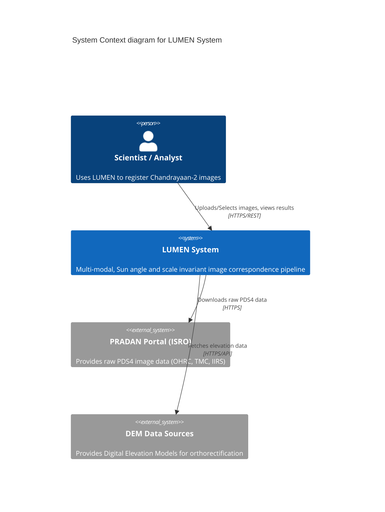
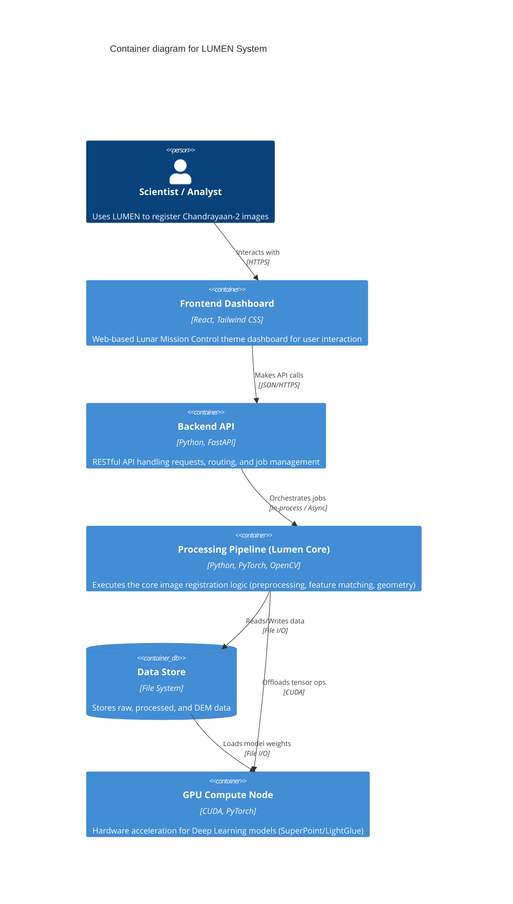
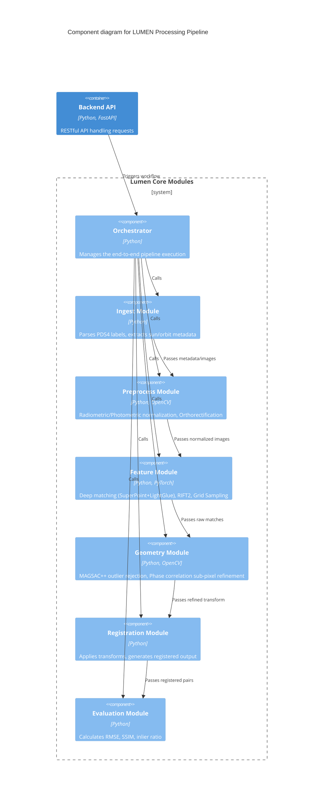
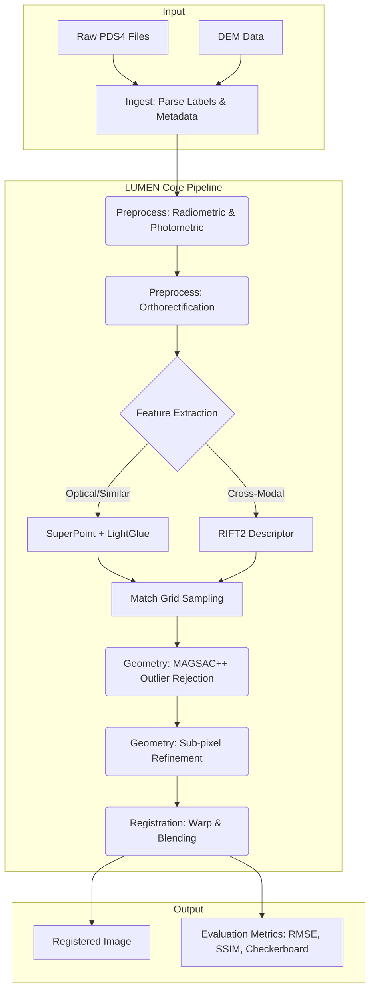
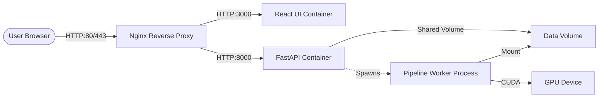

# LUMEN - Lunar Multi-modal Engagement Network
## Architecture Document

## 1. System Context Diagram (C4 Level 1)

## 2. Container Diagram (C4 Level 2)

## 3. Component Diagram (C4 Level 3)

## 4. Data Flow Architecture

## 5. Key Design Decisions

*   **SuperPoint + LightGlue over SIFT/ORB**: Traditional handcrafted features struggle with the extreme illumination variations and lack of distinct texture in lunar regolith. SuperPoint extracts learned, robust features, while LightGlue performs attention-based matching that excels under extreme viewpoint and lighting changes.
*   **RIFT2 for Cross-Modal Registration**: RIFT2 (Radiation-variation Insensitive Feature Transform) uses phase congruency instead of image intensity, making it highly robust to non-linear radiometric differences (e.g., matching optical OHRC with different sensor modalities).
*   **MAGSAC++ over RANSAC**: MAGSAC++ eliminates the need to fine-tune inlier threshold parameters and utilizes marginal scoring, resulting in far more robust and accurate geometric model estimation under high outlier ratios common in lunar imagery.
*   **Phase Correlation for Sub-pixel Refinement**: Operates in the frequency domain, providing highly accurate sub-pixel translation estimation without relying on local feature point stability, which is crucial for the high-resolution OHRC images (0.25m GSD).
*   **Lommel-Seeliger Photometric Normalization**: Specifically chosen as it models the scattering properties of the lunar surface (particulate regolith) far better than Lambertian models, effectively normalizing extreme sun angle variations.
*   **FastAPI Backend**: Chosen for its high performance (async support), automatic OpenAPI (Swagger) documentation generation, and type safety using Pydantic, making pipeline integration and frontend communication robust.

## 6. Technology Stack

*   **Language:** Python 3.11+
*   **Deep Learning / Tensors:** PyTorch (SuperPoint, LightGlue)
*   **Image Processing:** OpenCV 4.x, scikit-image
*   **Geospatial / I/O:** GDAL, Rasterio
*   **Numerical:** NumPy, SciPy
*   **Backend / API:** FastAPI, Uvicorn, Pydantic
*   **Frontend:** React, Tailwind CSS
*   **Infrastructure:** Docker, Docker Compose
*   **Testing:** pytest

## 7. API Design

The RESTful API provides endpoints for job submission, monitoring, and retrieval of results.

| Endpoint | Method | Description |
| :--- | :--- | :--- |
| `/api/v1/register` | `POST` | Start a new image registration job. Accepts image identifiers/files and returns a Job ID. |
| `/api/v1/jobs/{id}` | `GET` | Get the status of a specific registration job (e.g., Pending, Processing, Completed, Failed). |
| `/api/v1/jobs/{id}/matches` | `GET` | Retrieve the geometric match points (inliers/outliers) for visualization. |
| `/api/v1/jobs/{id}/metrics` | `GET` | Get quantitative evaluation metrics (RMSE, SSIM, etc.). |
| `/api/v1/preprocess` | `POST` | Run standalone preprocessing (radiometric/photometric normalization) without full registration. |
| `/api/v1/sensors` | `GET` | List supported Chandrayaan-2 sensors (OHRC, TMC, IIRS) and capabilities. |

## 8. Deployment Architecture

## 9. Performance Considerations

*   **GPU Acceleration**: Essential deep learning models (SuperPoint, LightGlue) and intensive matrix operations are offloaded to CUDA-enabled GPUs to drastically reduce processing time.
*   **Image Pyramid Strategy (Coarse-to-Fine)**: To handle massive high-resolution imagery (like OHRC), the system performs initial matching on down-sampled image pyramids, then refines the transform matrix on native resolution patches.
*   **Batch Processing**: The feature extraction and matching modules are vectorized and support batch processing to maximize GPU utilization.
*   **Grid Sampling**: Prevents localized dense matching and ensures a uniform spatial distribution of keypoints across the image, reducing computational load in MAGSAC++ while improving global transformation accuracy.

## 10. Security & Data Handling

*   **PDS4 Data Integrity**: Checksum validation and strict PDS4 schema compliance checks are enforced during the ingest phase to ensure raw data isn't corrupted.
*   **Audit Logging**: All API requests, job status changes, and pipeline errors are logged centrally for debugging and audit purposes.
*   **Ephemeral Processing Storage**: Intermediate artifacts generated during preprocessing and matching are stored in ephemeral volumes and routinely garbage-collected to prevent storage exhaustion.
*   **Input Validation**: Strict Pydantic schemas validate all inbound API payloads to prevent injection attacks and ensure robust type handling.
