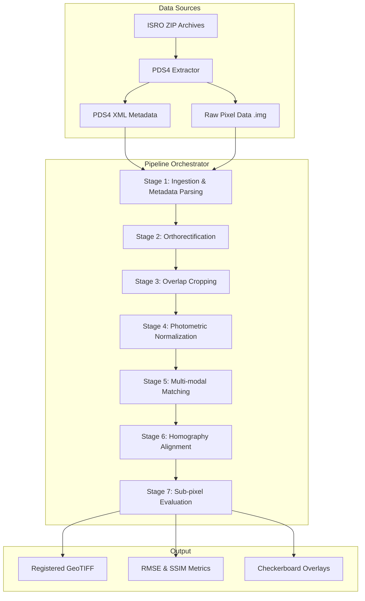

# LUMEN Architecture

The LUMEN (Lunar Multi-Sensor Registration) pipeline is designed to automate the ingestion, standardization, and sub-pixel geometric alignment of disparate orbital datasets from ISRO's Chandrayaan-2/3 missions (TMC-2, OHRC, IIRS).

## Data Flow Diagram

## The 7-Stage Pipeline

LUMEN employs a highly modular, 7-stage architecture to rigorously process PDS4 archives down to sub-pixel accuracy.

### 1. Ingestion & Metadata Parsing
- **Rationale**: ISRO delivers data in the planetary standard PDS4 format. Imagery is separated into raw binary `.img` files and `.xml` sidecars. 
- **Action**: The `PDS4Ingester` reads the XML, extracting critical metadata such as native resolution (GSD), solar incidence/emission angles, and the bounding footprint coordinates.

### 2. Orthorectification
- **Rationale**: Spacecraft capture distorted images due to camera angle and planetary curvature. Raw pixels cannot be compared directly.
- **Action**: Uses `rasterio` and GDAL to warp the raw `.img` pixels onto a flat Geographic Coordinate System (EPSG:4326). It utilizes Ground Control Point (GCP) CSVs or pixel-level location images (IIRS) to perform the reprojection. 
- **Tech Stack**: Python `rasterio.warp.reproject` using `Resampling.lanczos`.

### 3. Overlap Cropping
- **Rationale**: Lunar strips are massive (often 100,000+ pixels tall). Processing the entire strip when only a tiny fraction overlaps with the reference image causes Out-of-Memory (OOM) crashes.
- **Action**: Uses `shapely` to calculate the exact geographic intersection polygon between the source and reference images. Both images are then cropped to this exact bounding box.

### 4. Photometric Normalization
- **Rationale**: Images captured on different orbits have drastically different lighting, shadows, and contrast, confusing AI feature matchers.
- **Action**: Applies Contrast Limited Adaptive Histogram Equalization (CLAHE) and performs solar angle compensation based on the XML metadata to standardize the visual appearance of craters.

### 5. Multi-modal Matching
- **Rationale**: To align the images, we must find identical physical features (like crater rims) in both images.
- **Action**: Uses feature detectors (SIFT, ORB, or SuperPoint) to extract keypoints. It then utilizes advanced matching algorithms (like MAGSAC++) to find correspondences that are invariant to scale and rotation.

### 6. Homography Alignment
- **Rationale**: Keypoint matches always contain false positives (outliers). 
- **Action**: Uses RANSAC (or MAGSAC++) to filter out bad matches and calculate a robust Transformation Matrix (Affine or Homography). This matrix defines how to geometrically stretch, rotate, and translate the source image to perfectly overlay the reference image.

### 7. Sub-pixel Evaluation
- **Rationale**: We must mathematically prove the accuracy of the alignment.
- **Action**: To avoid bias, the pipeline applies the calculated transformation matrix to a *completely independent* set of keypoints (e.g., extracted via a different algorithm). It calculates the Root Mean Square Error (RMSE) to prove sub-pixel accuracy, and generates checkerboard overlays for visual human verification.
