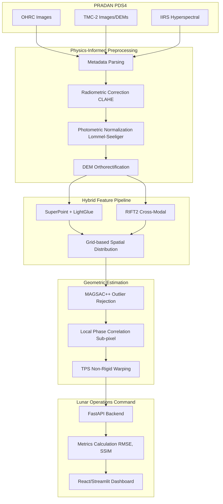

# Product Requirements Document (PRD): LUMEN (Lunar Multi-modal Engagement Network)

**Project:** Multi-modal, Sun angle and scale invariant image correspondence using Chandrayaan-2 optical images (OHRC, TMC and IIRS)  
**Target Audience:** ISRO SIH Judges, Planetary Scientists, Mission Planners  
**Version:** 1.0  
**Date:** August 28, 2026  

---

## 1. Executive Summary

The Lunar Multi-modal Engagement Network (LUMEN) is a comprehensive software suite designed to achieve sub-pixel accurate image correspondence between Chandrayaan-2's diverse optical payloads: the Orbiter High Resolution Camera (OHRC), Terrain Mapping Camera-2 (TMC-2), and Imaging IR Spectrometer (IIRS). LUMEN overcomes critical lunar imaging challenges—drastic illumination variations, extreme scale differences (up to 320:1), viewpoint changes, and multi-modal characteristic discrepancies—by employing a novel hybrid computer vision pipeline. By bridging deep learning-based feature extractors with traditional physics-based photometric normalization and robust geometric estimation, LUMEN empowers ISRO scientists to seamlessly fuse high-resolution landing site characterizations with broader mineralogical and topological maps.

## 2. Problem Statement & Background

### Context

Lunar exploration relies heavily on remote sensing data acquired from orbiting platforms. Chandrayaan-2 has mapped the Moon at unprecedented resolutions, providing an invaluable dataset for future landing missions and scientific discoveries. However, integrating this data is severely hindered by the fundamental differences in how the sensors capture the lunar surface.

### The Challenge of Image Registration for Lunar Missions

Finding correspondence (registration) between lunar images is complex due to:
*   **Illumination Variation:** The Moon lacks an atmosphere to scatter light. Consequently, changes in solar azimuth and elevation create radically different shadow patterns, making the same terrain look completely different across acquisitions.
*   **Scale Variation:** The ground sampling distance (GSD) ranges from ~0.25m (OHRC) to 5m (TMC-2) and ~80m (IIRS). Matching features across a 320:1 scale ratio is computationally and algorithmically non-trivial.
*   **Multi-modal Differences:** Panchromatic sensors (OHRC, TMC-2) capture structural details, while hyperspectral sensors (IIRS) capture mineralogical signatures across 256 bands (0.8-5.0 µm).
*   **Featureless Terrain:** Many lunar regions lack distinct, easily matchable features, leading to sparse or unevenly distributed correspondence points.

> [!CAUTION]
> Failing to accurately co-register these datasets severely limits the scientific yield of the Chandrayaan-2 mission and increases risks for future surface operations that rely on fused high-resolution maps.

## 3. Goals & Success Metrics

### Primary Goals
1.  Develop an automated, end-to-end pipeline for cross-sensor image registration of Chandrayaan-2 data.
2.  Achieve robustness against severe sun angle, viewpoint, and scale variations.
3.  Provide an intuitive "Lunar Operations Command" dashboard for interactive analysis and quality assessment.

### Success Metrics (KPIs)

| Metric | Target | Description |
| :--- | :--- | :--- |
| **Accuracy (RMSE)** | < 1.0 pixel | Root Mean Square Error of the final registered image relative to the reference. |
| **Inlier Ratio** | > 70% | The percentage of matched feature points deemed correct by the geometric estimation model. |
| **Scale Tolerance** | Up to 1:320 | Ability to match OHRC (~0.25m) directly to IIRS (~80m). |
| **Processing Time** | < 120s per pair | Total time from PDS4 ingestion to final registered image for a standard 4Kx4K image crop. |
| **Spatial Distribution** | > 80% coverage | Matches must be distributed across the entire overlapping region, not clustered in one high-texture area. |

## 4. User Personas

1.  **ISRO Planetary Scientist:** Needs to overlay hyperspectral mineralogy (IIRS) onto high-resolution topography (TMC-2/OHRC) to identify resources for future missions. Values high sub-pixel accuracy and detailed evaluation metrics.
2.  **Lunar Mission Planner:** Requires extremely precise co-registration of OHRC landing site imagery with TMC-2 DEMs to simulate descent trajectories and identify hazards. Values reliability and visualization tools.
3.  **Data Processing Engineer:** Manages the batch processing of thousands of image pairs from the PRADAN portal. Values API access, headless operation, and robust error handling.

## 5. Functional Requirements (FR)

### Data Ingestion & Preprocessing

*   **FR-01: PDS4 Data Ingestion (P0)**
    *   System must parse standard ISRO PDS4 formats downloaded from the PRADAN portal (`pradan.issdc.gov.in`).
    *   Must extract primary image data arrays and associated metadata.
*   **FR-02: Multi-sensor Metadata Extraction (P0)**
    *   Extract critical acquisition geometry: Solar Azimuth, Solar Elevation/Incidence angle, Emission angle, Phase angle, Spacecraft position/orientation.
*   **FR-03: Radiometric Preprocessing (P1)**
    *   Implement basic corrections including Contrast Limited Adaptive Histogram Equalization (CLAHE) and histogram matching to normalize general intensity distributions.
*   **FR-04: Sun-angle Photometric Normalization [NOVEL] (P0)**
    *   Implement physics-based photometric correction using Lommel-Seeliger and Minnaert reflectance models.
    *   Normalize images to a standard illumination geometry to mitigate shadow-induced feature mismatch.
*   **FR-05: DEM-based Orthorectification (P1)**
    *   Utilize TMC-2 derived Digital Elevation Models (DEMs) to correct terrain distortions prior to feature matching.

### Feature Pipeline

*   **FR-06: Multi-scale Feature Detection (P0)**
    *   Implement Deep Learning-based sparse feature extraction using SuperPoint.
    *   Utilize LightGlue for robust, outlier-resistant initial feature matching.
*   **FR-07: Cross-modal Feature Matching (P0)**
    *   Implement RIFT2 (Radiation-variation Insensitive Feature Transform) as a secondary pipeline specifically for matching structural (OHRC) to spectral (IIRS) data where gradient-based methods fail.
*   **FR-08: Uniform Spatial Distribution [NOVEL] (P1)**
    *   Implement grid-based uniform sampling during the feature detection phase to force the algorithm to find correspondences across the entire overlapping footprint, preventing clustering in craters.

### Geometric Estimation & Registration

*   **FR-09: Robust Geometric Estimation (P0)**
    *   Implement MAGSAC++ for superior outlier rejection compared to standard RANSAC.
    *   Use Thin Plate Splines (TPS) to model non-rigid deformations caused by residual uncorrected terrain effects.
*   **FR-10: Sub-pixel Refinement [NOVEL] (P0)**
    *   Apply phase correlation techniques on local patches around initial matched points to achieve sub-pixel translation estimation.
*   **FR-11: Image Warping/Registration (P0)**
    *   Warp the source image to the reference coordinate system using the estimated transformation matrix.

### Interface & Operations

*   **FR-12: Evaluation Metrics Dashboard (P1)**
    *   Calculate and display RMSE, Inlier Ratio, Reprojection Error, and Structural Similarity Index (SSIM).
    *   Provide visual evaluation tools: checkerboard overlays, color-coded displacement vectors, and alpha-blending toggles.
*   **FR-13: REST API (P1)**
    *   Provide a FastAPI backend exposing endpoints for triggering pipelines, checking status, and retrieving results.
*   **FR-14: Interactive Visualization Dashboard (P0)**
    *   Provide a React/Streamlit frontend utilizing the "Lunar Operations Command" design system.
    *   Include a 3D visualization of acquisition geometry.
*   **FR-15: Batch Processing Mode (P2)**
    *   Allow ingestion of CSV files defining hundreds of pairs for unattended pipeline execution.

### Architecture Diagram

## 6. Non-Functional Requirements (NFR)

*   **Performance:** The pipeline must leverage GPU acceleration (CUDA) via PyTorch for neural network inference (SuperPoint/LightGlue) to meet the < 120s processing time goal.
*   **Scalability:** The architecture must be containerized (Docker) to allow seamless deployment on ISRO HPC clusters or cloud environments.
*   **Maintainability:** Code must adhere to PEP8 standards, with comprehensive docstrings and unit test coverage > 80%.
*   **Usability:** The frontend must enforce a dark, high-contrast theme (space-themed with amber accents `#F59E0B`) suitable for low-light operation rooms, following the pre-designed Stitch UI.

## 7. Out of Scope

*   Direct download capabilities from the live PRADAN portal (users must provide downloaded PDS4 files).
*   Generation of new DEMs from stereo TMC-2 pairs (assumes TMC-2 DEMs are already available).
*   Real-time processing of orbital video feeds.

## 8. Technical Risks & Mitigations

| Risk | Impact | Likelihood | Mitigation Strategy |
| :--- | :--- | :--- | :--- |
| **Extreme Scale Ratio (1:320)** | High | High | Implement a Gaussian image pyramid approach. Downsample OHRC to match TMC-2, find correspondence, then use TMC-2 to bridge to IIRS. |
| **GPU Memory Exhaustion** | High | Medium | Implement patch-based processing for massive OHRC strips. Process features in tiles and merge correspondences. |
| **Failure of Photometric Models** | Medium | Low | Fallback to purely deep-learning based feature matching (SuperPoint is somewhat invariant to illumination). Provide manual tie-point selection in UI as a last resort. |

## 9. Release Plan / Milestones

*   **Milestone 1 (M1): Foundation**
    *   PDS4 ingestion, metadata extraction, baseline SuperPoint/LightGlue pipeline working on 1:1 scale data.
*   **Milestone 2 (M2): Physics & Scale**
    *   Implementation of Photometric Normalization and Image Pyramids to handle OHRC to TMC-2 scale variations.
*   **Milestone 3 (M3): Cross-Modal & Precision**
    *   Integration of RIFT2 for IIRS matching. Implementation of Phase Correlation for sub-pixel accuracy.
*   **Milestone 4 (M4): UI & API Delivery**
    *   Finalize FastAPI backend and React/Streamlit 'Lunar Operations Command' dashboard. Full end-to-end integration testing.

## 10. References

*   ISRO PRADAN Portal: [https://pradan.issdc.gov.in](https://pradan.issdc.gov.in)
*   DeTone, D., Malisiewicz, T., & Rabinovich, A. (2018). SuperPoint: Self-Supervised Interest Point Detection and Description.
*   Lindenberger, P., et al. (2023). LightGlue: Local Feature Matching at Light Speed.
*   Li, J., et al. (2019). RIFT: Radiation-variation Insensitive Feature Transform for Multisensor Image Matching.
